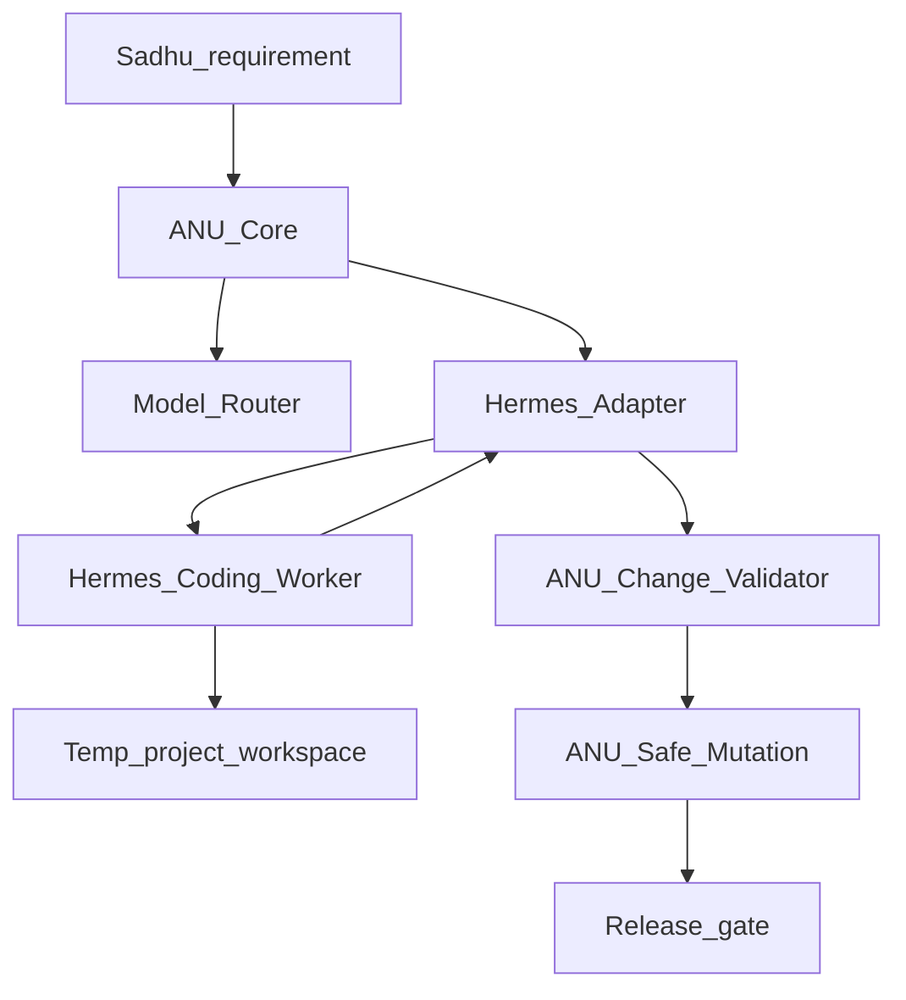

# ANU × Hermes — Integration Strategy

| | |
|---|---|
| **Status** | Planning |
| **Baseline branch** | `v0.9.0-integration` |
| **Baseline commit** | `deb619f` (21 Oct 2026) |
| **Host** | Raspberry Pi 5, 8 GB, ARM64, Debian 13 |
| **Principle** | Intelligence is replaceable; the security boundary is not |

Hermes is a **specialised coding worker**. ANU remains the **control plane**:
runtime, brain, planner, scheduler, guardian, Safe Mutation, git, and human
release gates. Do not embed Hermes source into ANU; install it as a
version-pinned, independent dependency.

Full version plans (implement one at a time):

| Version | Plan | Focus |
|---|---|---|
| [V1.1](versions/v1.1.md) | Baseline hardening | Cost accounting, CI, real lab E2E, docs |
| [V1.2](versions/v1.2.md) | Hermes standalone | ARM64 CLI, models, blank-slate tools |
| [V1.3](versions/v1.3.md) | Isolated execution | `anu-hermes` user, rootless Podman, temp workspace |
| [V1.4](versions/v1.4.md) | Hermes adapter | Job contract, adapter/worker/result, systemd |
| [V1.5](versions/v1.5.md) | Verification handoff | Patch → Safe Mutation → matrix → repair |
| [V1.6](versions/v1.6.md) | Release integration | `agent/*`, gated PR, dashboard visibility |

**Do not start V1.2 until V1.1 exit criteria pass** (and prefer a frozen V1.0
lab-repo baseline first — see [versions/v1.0.md](versions/v1.0.md)).

## Architecture



```text
Hermes proposes and implements.
ANU decides whether the implementation is allowed,
correct enough to accept, and ready for release.
```

Hermes must never own ANU task state, production credentials, or release
authority.

## Keep / adopt / replace

| Component | Decision |
|---|---|
| Python runtime, Guardian, SQLite Brain, Scheduler, Goal Controller | Keep |
| Model Gateway + LLM Router | Keep; fix accounting (V1.1); extend later |
| Deterministic Change Generator | Keep as fallback for todo/ping/greet |
| Safe Mutation, Command Gateway, verification sandbox | Keep (mandatory gates) |
| Test Matrix, Git Workflow | Keep and strengthen |
| Dashboard | Extend in V1.6 for Hermes job monitoring |
| Hermes CLI / selected skills | Adopt as separate worker (V1.2+) |
| Hermes memory as source of truth | No — ANU SQLite stays authoritative |
| Hermes cron / subagents / browser / messaging | Disable initially |

## Five gaps (why Hermes)

1. **Not a general coding engine** — for unfamiliar goals,
   `prepare_for_task()` falls through to `ensure_noop_changes()`. Hermes fills
   the implement stage for real source + tests.
2. **Model gateway ≠ Hermes endpoint** — current gateway is Unix-socket
   `health`/`chat`/`reason`; router `_http_chat()` does not pass tool-call
   schemas. Hermes needs its own providers or a later adapter, not a blind
   point-at-ANU-gateway.
3. **Cost accounting** — router records `usd=0.0` in both branches; daily
   spend limits cannot enforce real cost until fixed (V1.1).
4. **Verification sandbox is read-only** — `anu-sandbox.yaml` has
   `network: none`, RO rootfs, project RO. Correct for tests; unsuitable as
   Hermes write workspace. Use a separate rootless Podman workspace (V1.3).
5. **Release evidence** — strengthen CI through V0.9.15 and a genuine
   scheduler→git lab acceptance before calling V1.0 frozen; reconcile
   network/push docs vs `lab-github.conf`.

## Model modes (ANU-owned policy)

| Mode | Where inference runs | Notes |
|---|---|---|
| **LOCAL** | LM Studio / Ollama on LAN PC | Prefer for private source |
| **CLOUD** | OpenRouter (etc.) when privacy allows | Not the same as `openrouter/free` |
| **AUTO** | ANU chooses by complexity, context, privacy, cost, health | Preferred long-term |

Do not run a large coding model on the Pi 8 GB competing with the ANU
runtime. Hermes needs ≥64K context and tool calling. Prefer an approved
catalogue if open-weight-only policy applies.

`openrouter/free` ≠ `openrouter/auto` — Auto is not a zero-cost guarantee.

## Security boundaries

| Boundary | Restriction |
|---|---|
| ANU host | Hermes cannot modify ANU system files under `/srv/anu` |
| Hermes worker | Dedicated non-root account; restricted workspace |
| Code execution | Rootless isolated container; no external network |
| Release | Human approval + CI/CD gates |

### Never grant Hermes

- `/srv/anu/secrets`
- Write access to the SQLite brain
- SSH private keys / GitHub push credentials
- Production env vars or deploy credentials
- Privileged Docker host socket
- Sudo

First experiment: blank-slate tools only — no subagent delegation, cron,
browser, or messaging integrations.

## Job contract (V1.4+)

ANU sends a structured job (temporary working copy — never a writable
`/srv/anu` mount). Hermes returns changed files, logs, and evidence with
`commit: false` and `push: false`. ANU validates paths/secrets, converts to
`file/old/new`, applies via Safe Mutation, and re-runs the matrix.

See [versions/v1.4.md](versions/v1.4.md) for full JSON shapes.

## Official references

- [Hermes Agent source](https://github.com/NousResearch/hermes-agent)
- [ARM64 platform support](https://hermes-agent.nousresearch.com/docs/getting-started/platform-support)
- [Terminal sandbox configuration](https://hermes-agent.nousresearch.com/docs/user-guide/configuration)
- [LLM provider configuration](https://hermes-agent.nousresearch.com/docs/integrations/providers)
- [ANU integration branch](https://github.com/Sadhu2005/Anu-AI-Agent/tree/v0.9.0-integration)

## Related ANU docs

- [AUTONOMY.md](AUTONOMY.md) — lab-repo goal + `agent/*` push
- [SECURITY-AUTONOMY.md](SECURITY-AUTONOMY.md) — secrets and lab push drop-in
- [ROADMAP.md](ROADMAP.md) — version ordering
- [LAB-REPO.md](LAB-REPO.md) — lab target vs agent stack
