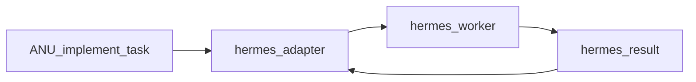

# ANU V1.4 — Hermes adapter (job commission)

| | |
|---|---|
| **Status** | In progress — contract and oneshot proved; live enqueue still disabled |
| **Date** | 2026-11-06 |
| **Branch** | `v1.4-integration` |
| **Tag / commit** | — |
| **Depends on** | [V1.3](v1.3.md) |
| **Strategy** | [HERMES-INTEGRATION.md](../HERMES-INTEGRATION.md) |

## Goal

Let ANU commission a real implementation job to Hermes and receive a validated
result payload — without Hermes committing, pushing, or writing ANU brain state.

## Scope

- In scope: adapter/worker/result modules; `anu-hermes.yaml`; systemd unit;
  job request/response JSON; path validation stub; convert to ANU
  `file/old/new` shape (apply in V1.5).
- Out of scope: Safe Mutation apply + matrix (V1.5); gated PR / dashboard polish
  (V1.6); replacing the deterministic change generator fallback.

## Design

### Proposed artefacts

| Component | Responsibility |
|---|---|
| `bin/anu-hermes-adapter-v0.1.py` | **new** — ANU→Hermes communication |
| `bin/anu-hermes-worker-v0.1.py` | **new** — supervise coding jobs |
| `bin/anu-hermes-result-v0.1.py` | **new** — collect/validate worker results |
| `config/anu-hermes.yaml` | **new** — permissions and timeouts |
| `deploy/systemd/anu-hermes.service` | **new** — isolated worker service |
| Deterministic `anu-change-generator` | **keep** — fallback for known lab demos |

### Job request (ANU → Hermes)

```json
{
  "job_id": "anu-goal-001-task-003",
  "project": "student-platform",
  "base_commit": "approved-commit-sha",
  "role": "implement",
  "goal": "Implement student authentication",
  "acceptance_criteria": [
    "Implement registration",
    "Implement login",
    "Validate inputs",
    "Add unit tests"
  ],
  "allowed_operations": [
    "read_files",
    "write_files",
    "run_tests",
    "inspect_logs"
  ],
  "network_access": false,
  "git_push": false,
  "production_access": false
}
```

Workspace: **temporary working copy** only — never writable `/srv/anu`.

### Job response (Hermes → ANU)

```json
{
  "job_id": "anu-goal-001-task-003",
  "status": "completed",
  "changed_files": ["src/auth.py", "tests/test_auth.py"],
  "test_summary": {"unit": "PASS"},
  "patch_available": true,
  "commit": false,
  "push": false
}
```

Also required: file contents or unified patch, base commit SHA, logs, errors.



## Changes

| File | Change |
|---|---|
| `bin/anu-hermes-adapter-v0.1.py` | **new** |
| `bin/anu-hermes-worker-v0.1.py` | **new** |
| `bin/anu-hermes-result-v0.1.py` | **new** |
| `config/anu-hermes.yaml` | **new** |
| `deploy/systemd/anu-hermes.service` | **new** |
| Task engine / controller hook | **edit** — route unknown implement goals to Hermes when enabled |
| `tests/test_hermes_adapter_v1_4.py` | **new** — unit |
| `tests/test_hermes_job_integration_v1_4.py` | **new** — integration |
| `tests/test_hermes_job_functional_v1_4.py` | **new** — functional |
| `tests/run_v1_4_regression.py` | **new** — regression pack |

## Tests

| Test | Proves |
|---|---|
| `test_hermes_adapter_v1_4.py` | Unit: request rules, path rejection, credential-free env |
| `test_hermes_job_integration_v1_4.py` | Integration: workspace, result boundary, brain sentinel, goal cycle unwired |
| `test_hermes_job_functional_v1_4.py` | Functional: one completed job, live execution disabled |
| `tests/run_v1_4_regression.py` | Those layers plus V1.3 and V0.9 packs |

## Exit Criteria

- [ ] ANU can enqueue a Hermes job and receive a completed/failed result
- [x] Result includes changed files + base SHA + logs; `commit`/`push` always false
- [x] Worker uses V1.3 temp workspace; no production credential injection
- [x] systemd unit runs as isolated user; documented in ops notes
- [x] Unit tests cover schema + path rejection

Live enqueue stays open. `config/anu-hermes.yaml` keeps `enabled: false` and
`execute: false`. The goal cycle does not call the adapter. Hermes refuses
tool use below 64K context, and this model window is 32K.

## Evidence

```text
CI 42166119757 on 59ffacb: Unit, Integration, Functional, Regression passed
Functional fixture: changed_files src/labapp/clamp.py, base_commit 1a8cd22,
  logs "fixture", commit false, push false (payload had asked for true)
Integration: jobs root outside /srv/anu, env only HERMES_DOCKER_BINARY=podman,
  killed runner left the brain sentinel unchanged
Pi 2026-11-06 04:56:50 UTC: /srv/anu detached at a429356
  anu-hermes.service User=anu-hermes, disabled oneshot
  {"ok": true, "execute": false, "spawn": false}
  Deactivated successfully
  anu-agent and anu-model-gateway active
  gateway http://192.168.1.13:11434/v1 model qwen2.5-coder:7b
  stash pre-v1.4-checkout left on v0.9.0-integration (do not pop)
Ops note: docs/PI-OPS.md
```

## Known Issues / Carried Forward

- Apply via Safe Mutation + independent matrix → [V1.5](v1.5.md)
- Dashboard job panel → [V1.6](v1.6.md)
